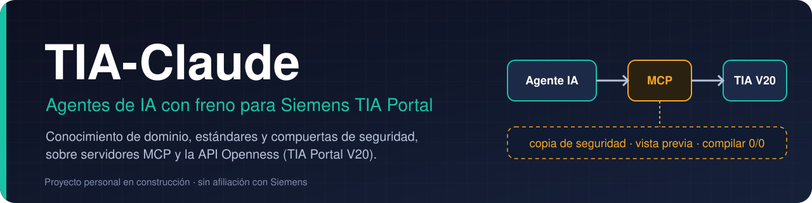
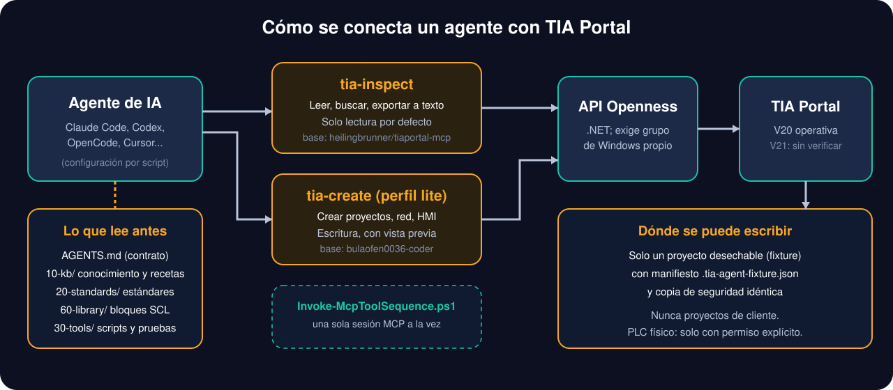
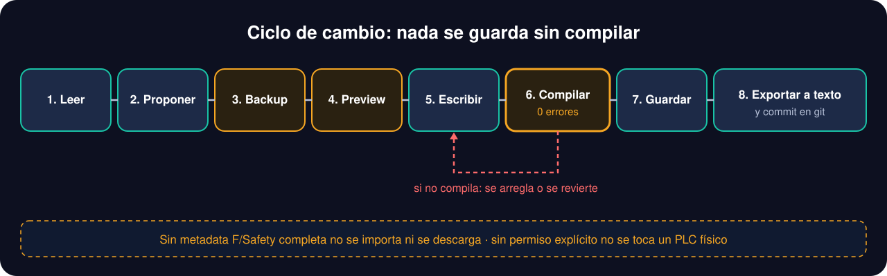

<div align="center">



<br>


**Un espacio de trabajo para que un agente de IA (Claude Code, Codex, OpenCode, Cursor...) opere Siemens TIA Portal**
con conocimiento del dominio, estándares de ingeniería y reglas duras de seguridad, a través de servidores MCP y la API Openness.
Es un proyecto personal de investigación sobre automatización industrial, **no un producto validado**.

[Qué hace](#qué-hace) ·
[Cómo funciona](#cómo-funciona) ·
[Estado](#estado-del-proyecto) ·
[Inicio rápido](#inicio-rápido) ·
[Límites](#límites-conocidos) ·
[Estructura](#estructura-del-proyecto)

</div>

---

## Qué hace

| | |
|---|---|
| 🧭 **Contrato para el agente** | [`AGENTS.md`](AGENTS.md) fija el orden de arranque, las reglas duras y cómo informar de lo verificado y lo no verificado. |
| 📚 **Base de conocimiento** | [`10-kb/`](10-kb/): cómo funciona Openness (rutas, límites, sesiones) y 31 recetas ([R01 a R31](10-kb/20-recetas/README.md)) con secuencia, verificación y modos de fallo. |
| 📏 **Estándares** | [`20-standards/`](20-standards/): nomenclatura, estilo SCL, estructura de proyecto y definición de «terminado». |
| 🧩 **Bloques SCL propios** | [`60-library/blocks/`](60-library/blocks/): motor, válvula, plantilla de secuencia, modos y alarma. |
| 🔌 **Dos servidores MCP** | `tia-inspect` (leer y exportar) y `tia-create` (crear), con perfiles `read`, `write`, `create` y `full`. Se compilan desde sus fuentes con `build.ps1` y parches propios. |
| 🧪 **Pruebas y checks** | 44 scripts de prueba en [`30-tools/tests/`](30-tools/tests/) y un runner, [`Run-WorkspaceChecks.ps1`](30-tools/scripts/Run-WorkspaceChecks.ps1). |
| 🎓 **Ejemplos** | [`50-examples/`](50-examples/): proyectos TIA de terceros, con ficha de lo que enseña cada uno, para probar sin tocar nada de un cliente. |

**Para quién es:** quien quiera experimentar con agentes de IA sobre TIA Portal y necesite una base prudente: lectura por defecto, escritura solo en copias desechables y cada resultado clasificado como verificado, supuesto, no verificado o bloqueado.

## Cómo funciona



### El ciclo de cambio



Las reglas más importantes, tal como las recoge [`AGENTS.md`](AGENTS.md):

- **PLCSIM, libre; hardware físico, nunca sin confirmación explícita en ese momento.** Si no se distingue un destino simulado de uno real, se asume real.
- **No se inventa ninguna ruta de Openness:** sale de `GetProjectTree` o no existe.
- **El agente no escribe LAD a mano.** SCL para la lógica; LAD solo desde recetas o bloques probados.
- **Escritura solo en un fixture desechable** con manifiesto y copia de seguridad coincidentes (`--isolated --fixture-root --allow-write`).
- **Bloques con protección de know-how o de seguridad (F/Safety) no se tocan.**
- Los resultados de `dryRun` nunca se presentan como cambios aplicados.

> Los gráficos de esta página son esquemas propios, no capturas de la interfaz de TIA Portal.

## Estado del proyecto

Un resumen honesto. La fuente más fiable es [`AGENTS.md`](AGENTS.md) y los informes de `70-runs/` (que no se versionan: se generan en local).

| Pieza | Estado | Nota |
|---|:---:|---|
| `tia-inspect` V20: `Doctor`, perfil `read` y sesión aislada de lectura | ✅ | Verificado en la máquina del autor; 53 herramientas en la captura del 2026-09-24. |
| `tia-create` V20 (perfil `lite`) | ✅ | Compilado y con prueba de humo MCP: 55 herramientas. |
| Ciclos offline en fixture aislado (tablas Watch, Instance DB, tablas de tags, grupos de bloques, importar tabla de tags) | ✅ | Recetas [R22 a R26](10-kb/20-recetas/README.md). Solo ingeniería offline, sin CPU. |
| Bloques SCL de `60-library/` | ✅ | Compilaron con 0 errores y 0 advertencias en TIA V20 (2026-09-14). `FC_Escalado` además se ha ejecutado en CPU virtual (2026-10-21). |
| Los 7 ejemplos migrados a V20, inventariados y exportados a texto | ✅ | 5 de 7 exportados; hay hallazgos documentados. |
| Análisis semántico de un snapshot y propuestas SCL | 🟡 | Hay preview y compuertas. La **aplicación** de propuestas está bloqueada por diseño mientras el perfil V20 no registre un importador acotado. |
| Aceptación en PLCSIM Advanced | ✅ | **Verificada en ejecución** (2026-10-21): `FB_AlarmLatch` (65/65 pasos, 9 casos) y `FC_Escalado` (33/33, 9 casos), solo contra CPU virtual. Recetas [R28](10-kb/20-recetas/R28-aceptacion-plcsim.md) y [ADR-015](00-meta/decisiones/ADR-015-estado-real-2026-10-21.md). |
| HMI (WinCC Unified/Comfort): recetas y aceptación | 🟡 | Documentado (R13, R14, R20), sin verificar en runtime. |
| Aceptación global (`accepted`) | 🚧 | Sigue en `false`: **PA-1 está cumplido** (proyecto `DEMO-Cinta01` creado desde un spec, 0/0, `Check-TiaStandards` con código 0, y la pregunta de trazabilidad respondida con referencias reales — ADR-016), pero **WinCC Unified Runtime no se ha arrancado nunca** y la simulación HMI sigue siendo el hueco de R13, R14 y R20. |
| Compatibilidad con TIA Portal V21 | 🚧 | Receta de compilación escrita, sin verificar (ADR-014). |
| CI en GitHub Actions | ✅ | En verde desde el 2026-10-21: 13 checks, 0 FAIL. Los dos tests que fallaban eran gates de seguridad que dejaron de ser comprobables. |

✅ probado · 🟡 implementado, pendiente de validar · 🚧 en construcción.

## Inicio rápido

Requisitos (los que no puede aportar este repositorio): **Windows**, **TIA Portal V20 con licencia Siemens**, pertenecer al grupo de Windows `Siemens TIA Openness` y **.NET SDK** para compilar los servidores. Los binarios de los servidores no se versionan.

```powershell
# 1. Compilar los servidores MCP (ver el README de cada carpeta)
30-tools\mcp\tia-inspect\build.ps1
30-tools\mcp\tia-create\build.ps1

# 2. Diagnóstico del entorno (no abre ningún proyecto)
30-tools\scripts\Invoke-TiaMcp.ps1 -Calls @(@{name='Doctor'})

# 3. Comprobaciones del espacio de trabajo
30-tools\scripts\Run-WorkspaceChecks.ps1
```

Después, lee [`AGENTS.md`](AGENTS.md): es el contrato que debe cargar cualquier agente. La configuración para Claude Code, Codex u OpenCode se exporta con [`Export-HarnessAdapter.ps1`](30-tools/scripts/Export-HarnessAdapter.ps1) y [`Sync-HarnessConfigs.ps1`](30-tools/scripts/Sync-HarnessConfigs.ps1) (guías en [`30-tools/harnesses/`](30-tools/harnesses/)).

<details>
<summary><b>Inventariar un proyecto desechable (solo lectura)</b></summary>

```powershell
$fixtureRoot = '90-tmp\runs\<fixture>'
$fixture = Get-Content (Join-Path $fixtureRoot '.tia-agent-fixture.json') -Raw | ConvertFrom-Json
30-tools\scripts\Invoke-TiaMcp.ps1 -Isolated -FixtureRoot $fixtureRoot -Calls @(
    @{ name='Connect' },
    @{ name='OpenProject'; args=@{ path=$fixture.projectPath } },
    @{ name='GetProjectTree' },
    @{ name='Disconnect' }
)
```

No lo uses con proyectos originales ni de cliente. Si TIA ya tiene un proyecto abierto, no lo cierres ni lances otra instancia: sigue [`AGENTS.md`](AGENTS.md).

</details>

<details>
<summary><b>Análisis semántico de un snapshot</b></summary>

Con un inventario MCP y sus fuentes exportadas se genera un dossier JSON y Markdown sin volver a abrir TIA:

```powershell
30-tools\scripts\Invoke-TiaProjectAnalysis.ps1 `
  -InventoryPath "...\inventory.json" `
  -SourceRoot "...\export" `
  -Objective "Entender el proyecto antes de proponer cambios"
```

Enlaza bloques con sus fuentes, cuenta lenguajes y tipos, detecta llamadas y separa hallazgos bloqueantes de avisos. Las propuestas SCL se generan como copias trazables; aplicarlas exige proyecto exacto, backup, preview, compilación limpia, guardado, exportación y lectura posterior.

</details>

<details>
<summary><b>Perfiles MCP</b></summary>

| Perfil | Servidor | Para qué |
|---|---|---|
| `read` | `tia-inspect` | Inspeccionar y exportar. Es el perfil por defecto. |
| `write` | `tia-inspect --isolated --fixture-root <dir> --allow-write` | Editar bloques estándar solo en un fixture con manifiesto. |
| `create` | `tia-create` | Proyectos nuevos, hardware, red y HMI. |
| `full` | ambos | Solo si la tarea necesita los dos; requiere reconocimiento explícito. |

Detalle en [`capacidades-y-alcance-por-conexion.md`](10-kb/10-openness/capacidades-y-alcance-por-conexion.md).

</details>

## Límites conocidos

- **No es una solución industrial validada.** Ninguna descarga a PLC ni prueba de comportamiento en simulación está aceptada todavía; compilar no equivale a probar el funcionamiento.
- El estado de aceptación global es `accepted=false`; las pruebas offline de release dependen de un paquete externo que falta.
- **Solo TIA Portal V20 está operativo.** V19 está preparada pero no soportada; V21 no está verificada.
- Los datos de rendimiento (tiempos de conexión, recuentos de herramientas) son capturas históricas de una máquina concreta, no garantías.
- Una etiqueta de riesgo o un nombre de herramienta no sustituyen la lectura de lo que hace: el catálogo completo de herramientas no está verificado una a una.
- El paquete portátil ([`TIA-Claude_Portable/`](TIA-Claude_Portable/README-INSTALL.md)) está pensado para uso privado entre equipos del autor.
- La simulación con PLCSIM Advanced depende de versiones concretas (TIA V20 con Advanced V7.0 o posterior) y de preflights de seguridad; sin ellos el flujo se detiene.

## Estructura del proyecto

```
AGENTS.md          contrato del agente (fuente de verdad); CLAUDE.md solo apunta a él
00-meta/           análisis, arquitectura, plan, ADR 001-017 y evaluación del conocimiento
10-kb/             base de conocimiento: Openness, recetas R01-R31, lenguajes, HMI, errores
\
40-projects/       el trabajo real: proyecto .ap20 + fuentes exportadas + ops
30-tools/          servidores MCP (build + parches), scripts PowerShell, PLCSIM, pruebas
50-examples/       ejemplos de terceros con ficha (ver licencias más abajo)
60-library/        bloques SCL propios
TIA-Claude_Portable/  paquete portátil: instalación, integridad y pruebas
docs/              planes y relevos de trabajo (docs/superpowers) y gráficos del README (docs/img)
```

## Documentación

- [`AGENTS.md`](AGENTS.md): contrato y reglas duras.
- [`00-meta/decisiones/`](00-meta/decisiones/): decisiones de arquitectura (ADR-001 a ADR-016). El [ADR-015](00-meta/decisiones/ADR-015-estado-real-2026-10-21.md) es la foto real del workspace tras la aceptación en PLCSIM, y el [ADR-016](00-meta/decisiones/ADR-016-pa1-cumplida.md) recoge PA-1 cumplida.
- [playbook GUI de TIA](10-kb/00-fundamentos/playbook-gui-tia.md): cómo el agente maneja la interfaz gráfica en esta máquina — jerarquía de herramientas, candado de clic con hit-test del PID y evidencia por paso.
- [10-kb/20-recetas/\](10-kb/20-recetas/README.md): recetas con su estado.
- [`SECURITY.md`](SECURITY.md): frontera pública; los proyectos de cliente, `.ap20`, contraseñas y material de seguridad funcional no van en este repositorio.
- [`CONTRIBUTING.md`](CONTRIBUTING.md).

## Licencia y créditos

El código propio (Markdown, PowerShell, SCL) se distribuye bajo [MIT](LICENSE). Los servidores MCP se construyen a partir de proyectos de terceros ([`heilingbrunner/tiaportal-mcp`](https://github.com/heilingbrunner/tiaportal-mcp) y [`bulaofen0036-coder/TIA_Portal_Openness_MCP`](https://github.com/bulaofen0036-coder/TIA_Portal_Openness_MCP), ambos con licencia MIT según [`NOTICE-THIRD-PARTY.md`](TIA-Claude_Portable/docs/NOTICE-THIRD-PARTY.md)); sus binarios no se distribuyen. Los ejemplos de `50-examples/` proceden de repositorios de terceros: sus licencias y condiciones son las de sus autores (el aviso de terceros indica que dos de ellos no incluyen fichero de licencia), así que no los reutilices sin comprobarlo.

---

<div align="center">

<sub>Proyecto personal, no afiliado a Siemens. «TIA Portal», «SIMATIC», «WinCC» y «PLCSIM» son marcas de sus propietarios.
Trabajar con PLC reales puede mover maquinaria y causar daños: no uses este material en producción sin una validación propia y cualificada.</sub>

</div>
